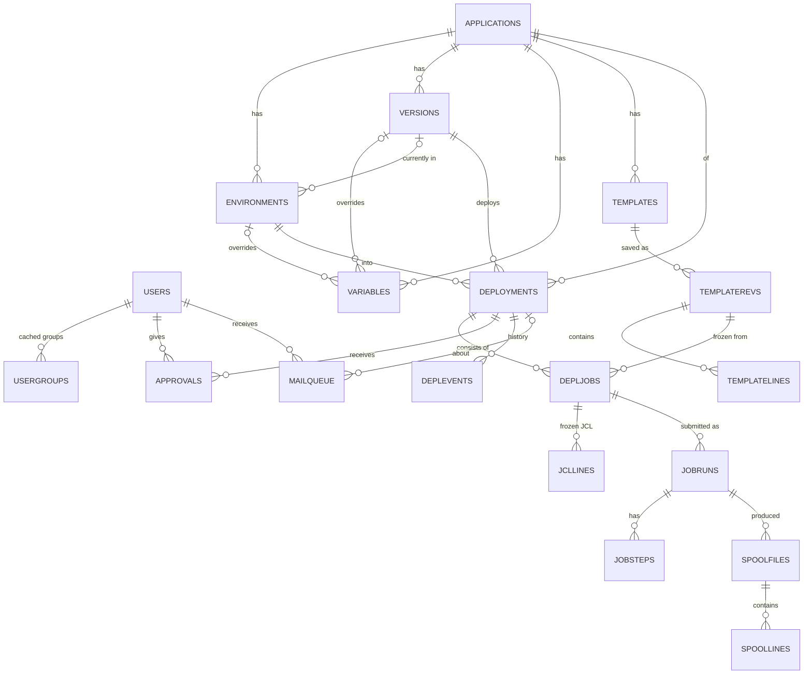

# DB2 data model

The tables behind the use cases in [02-use-cases.md](02-use-cases.md). The DDL is
in `DDL/AA0000nn.sql`, the change log in `DDL/$INFO.txt` and the names per
environment in `envs/t01.yaml`.

## Overview



The tables form four groups:

| Group | Tables | Changes |
|---|---|---|
| Setup | REFTABLES, APPLICATIONS, ENVIRONMENTS, VARIABLES, TEMPLATES, TEMPLATEREVS, TEMPLATELINES | Now and then, by owners and admins |
| Versions | VERSIONS | After every build |
| Deployments | DEPLOYMENTS, DEPLJOBS, JCLLINES, APPROVALS, DEPLEVENTS, JOBRUNS, JOBSTEPS | With every deployment |
| Output and people | SPOOLFILES, SPOOLLINES, USERS, USERGROUPS, MAILQUEUE | Constantly; output and mail are purged |

## Conventions

The same as in `ctfdlww`:

- `CCSID UNICODE`, GRAPHIC/VARGRAPHIC for text, and one tablespace per table.
  The three tables of JCL and output lines are compressed.
- Every table ends with CREATEDBY, CREATEDDATE, UPDATEDBY and UPDATEDDATE. They
  are left out of the column lists below. Where a use case talks about "who"
  and "when" (requester, approver, who changed a template), these are the
  columns meant.
- Foreign keys are `ON DELETE RESTRICT`, so COBOL deletes children first.
- There are no CHECK constraints: value checks live in the `LWDMnnn` modules,
  as reason codes `08 0x`.
- One-character codes, with their meaning in the header of the module.
- Logical names here; in COBOL the tables are `TBLWDnnn`.

## Access through FACILITY profiles

Applications and environments name RACF groups. Whether a userid is "in" a
group is decided by RACF, not by LWD (M7):

| Question | How |
|---|---|
| Is this userid in group G? | `QUERY SECURITY RESCLASS('FACILITY') RESID('<GRPPRFX>.G')`, READ access means yes |
| Is this userid an administrator? | `QUERY SECURITY` on the resource in setting `ADMINRES` |

Every action checks the groups it needs at that moment. That's cheap, because
FACILITY is RACLISTed. Lists are different: M1 (my applications) and AP1
(requests for me) must filter on "any group the user is in", and static SQL
can't take a list of groups of varying length. So the groups a user is in are
cached in USERGROUPS:

1. When a list is asked for and `USERS.GROUPSCHECKED` is older than `GRPMINS`
   minutes, the backend checks every group in the `RACFGRP` allowlist with
   `QUERY SECURITY` and rewrites the user's USERGROUPS rows.
2. The list queries join USERGROUPS.

The cache only decides what is *listed*. A user removed from a group may still
see an application in a list for `GRPMINS` minutes, but opening it, deploying
or approving is checked live and refused.

RACF set-up per group, for `t01`:

```
RDEFINE FACILITY LWD.T01.GRP.group UACC(NONE)
PERMIT  LWD.T01.GRP.group CLASS(FACILITY) ID(group) ACCESS(READ)
SETROPTS RACLIST(FACILITY) REFRESH
```

The profiles must be discrete. A generic `LWD.T01.GRP.*` with anyone on its
access list would put them in every group.

## Deployments

### Status codes

| Table.column | Codes |
|---|---|
| DEPLOYMENTS.DEPLSTATUS | W awaiting approval, J rejected, E expired, Q queued, U running, F failed, S succeeded, C cancelled |
| DEPLJOBS.JOBSTATUS | W waiting, S submitted (a run is going), D done, F failed, K skipped |
| JOBRUNS.RUNSTATUS | N new, S submitted, E ended, F failed |
| JOBRUNS.JOBRESULT | O within the highest RC, H above it, A abend, X submit failed, T no result in time |
| JOBRUNS.OUTPUTSTATUS | W waiting, C collected, N none found, P purged |

REQUESTED, in the lifecycle of [01-actors.md](01-actors.md#deployment-lifecycle),
is not stored: D1 commits the deployment as W or Q straight away.

### Deployment, job and run

- A **deployment** (DEPLOYMENTS) copies what it was requested with: the deploy
  userid, the approver group and the number of approvals N. Later changes to
  the environment (A2) don't affect it.
- A **job** of a deployment (DEPLJOBS) is one template, in order, with its
  frozen JCL (JCLLINES) and highest RC. Frozen when the deployment is
  requested.
- A **run** (JOBRUNS) is one submission of a job. A retry (D4) is a new run of
  the same job. Return codes and output belong to the run, so an earlier
  failed run stays readable after a retry.

The frozen JCL holds only the steps. At each submission, S1 wraps it:

```
//LTxxxxxx JOB ,'LWD 123/2',CLASS=A,MSGCLASS=X,USER=DEPLOYID     <- run key
//...      frozen JCL of the job
//LWDRS    IF (ABEND) THEN
//LWDRSA     EXEC PGM=IKJEFT1B,PARM='...LWDM9xx run A'
//         ELSE
//LWDRSRC    IF (RC <= 4) THEN                        <- the job's highest RC
//LWDRSO       EXEC PGM=IKJEFT1B,PARM='...LWDM9xx run O'
//           ELSE
//LWDRSH       EXEC PGM=IKJEFT1B,PARM='...LWDM9xx run H'
//           ENDIF
//         ENDIF
```

This is a sketch for the design of S1 and S2; the exact statements follow
there. What matters for the model:

- **Job name** = setting `JOBPRFX` (2 characters) + RUNID in base 36 (6
  characters, enough for every INTEGER). It is unique (index on JOBNAME), so S3
  can match output to its run.
- **The result step** only learns which of the three outcomes it is in, from
  the `IF` tests. That is enough for S2 to move on. The exact return codes of
  the job and of every step come later, from the system messages in the
  collected output (S3), into JOBRUNS.JOBRC/ABENDCODE and JOBSTEPS.
- **Token:** as in CTF, JOBRUNS.JOBHASH holds the hash of the token the backend
  passes to the submit task, and is cleared once submitted.

### Variables

Templates refer to variables as `${NAME}`, which can't be mistaken for JCL
symbols (`&NAME`). Names are 1-16 characters, `A-Z`, `0-9` and `_`, starting
with a letter. Names starting with `LWD` are built in:

| Variable | Value |
|---|---|
| `LWDAPP` | APPLICATIONS.APPCODE |
| `LWDENV` | ENVIRONMENTS.ENVCODE |
| `LWDVER` | VERSIONS.VERSIONNAME |
| `LWDLOC` | VERSIONS.LOCATION |
| `LWDDEPL` | DEPLOYMENTS.DEPLID |

Otherwise the value comes from the most specific level that defines it:
version, then environment, then application. All three live in VARIABLES; the
level follows from which of ENVID and VERSIONID are filled in:

| ENVID | VERSIONID | Level |
|---|---|---|
| NULL | NULL | Application |
| set | NULL | Environment |
| NULL | set | Version |

The unique index on (APPID, ENVID, VERSIONID, VARNAME) also works for the NULLs:
DB2 for z/OS treats NULLs as equal in a unique index, so a name can occur only
once per level.

A resolved line may be at most 80 characters, the length of LINETEXT (D1).

## Rules that need care

| Rule | How it is kept |
|---|---|
| One active deployment per environment | `UPDATE ENVIRONMENTS SET ACTIVEDEPLID = :D WHERE ENVID = :E AND ACTIVEDEPLID IS NULL`: no row updated means busy. Cleared on SUCCEEDED and CANCELLED, kept on FAILED |
| N distinct approvers | Primary key of APPROVALS (DEPLID, USERID). Then `UPDATE DEPLOYMENTS SET APPROVEDCOUNT = APPROVEDCOUNT + 1, DEPLSTATUS = CASE WHEN APPROVEDCOUNT + 1 >= APPROVALCOUNT THEN 'Q' ELSE 'W' END WHERE DEPLID = :D AND DEPLSTATUS = 'W'`, in the same unit of work, so two approvers at once can't both miss or overshoot N |
| Requester never approves | COBOL compares DEPLOYMENTS.CREATEDBY with the CICS userid |
| A run is submitted once | The submit task sets RUNSTATUS from N to S with `WHERE RUNSTATUS = 'N'` and checks the token (CTF pattern) |
| One state change wins | Every status change has the old status in its `WHERE`; no row updated means someone else was first, for example a cancel and a job end at the same time |
| Versions frozen once used | O4 refuses edits and deletes when a DEPLOYMENTS row refers to the version |
| Promotion gate | `EXISTS` a SUCCEEDED deployment of this version into the environment just before it in SORTORDER, using the index (VERSIONID, ENVID, DEPLSTATUS) |
| Inventory | S2 sets ENVIRONMENTS.CURRENTDEPLID, CURRENTVERSIONID and ENVSTATE `O` when a deployment succeeds; ENVSTATE `H` when one fails after it started |
| Allowed groups and deploy userids | COBOL checks them against `RACFGRP` and `DEPLUSER` in REFTABLES. A foreign key can't express this |
| Template history | Saving a template inserts a new TEMPLATEREVS row with its lines and sets TEMPLATES.CURRENTREV; old revisions are never changed. A deleted template gets TEMPLATESTATUS `D` and keeps its revisions |
| No foreign key on the environment's deployment columns | ENVIRONMENTS.ACTIVEDEPLID and CURRENTDEPLID point to DEPLOYMENTS, which points back to ENVIRONMENTS. Kept by COBOL, which avoids the cycle at create and delete time. The same goes for DEPLJOBS.LASTRUNID |

## Output and purging

Output can be large, so:

- SPOOLLINES stores lines of at most 255 characters; longer lines are cut off.
- At most `OUTLINES` lines are stored per run; then SPOOLFILES.TRUNCATED is
  `Y`.
- S4 (`LWDM940`, in the scheduled job) deletes the lines and files of runs
  whose ENDEDDATE is older than `OUTDAYS` days, committing after each run, at
  most 50 runs per tick, and sets OUTPUTSTATUS to
  `P`. The runs, steps and return codes stay.
- Sent mail older than `OUTDAYS` days is deleted by S4 too.

## Settings

REFTABLES lists: allowed RACF groups (`RACFGRP`), allowed deploy userids
(`DEPLUSER`), the Entra application of each deploy userid (`DEPLAPP`: key
the userid, value the client ID, which LWW maps to that userid), and
`SETTINGS`. `SETTINGS` and the `DEPLAPP` entry of the environment's deploy
userid are seeded by `DDL/SETTINGS.sql` from `envs/<env>.yaml`; `DEPLAPP`
can't be changed through the API:

| Key | Meaning | t01 |
|---|---|---|
| ADMINRES | FACILITY resource of administrators | `LWD.T01.ADMIN` |
| GRPPRFX | Prefix of the FACILITY profile per group | `LWD.T01.GRP` |
| GRPMINS | Minutes the cached groups stay valid | 15 |
| JOBPRFX | First two characters of job names | `LT` |
| JOBCLASS, MSGCLASS | Classes of the deployment jobs | `A`, `X` |
| EXECLIB | Library of the result step: REXX LWDR916 | `YINCIC.CPSM.T01.LWD.EXEC` |
| LWDURL, LWDPORT, LWDPATH | Where the result step finds LWD's REST API | `https://<host>`, `<port>`, `/lwdeploy/API/v1` |
| LWDRING | Key ring the result step trusts the certificates of LWW and Entra with | `*AUTH*/*` |
| TENANT, APISCOPE | Entra tenant, and scope of LWD's API (`<application ID>/.default`), for the result step's access token | placeholders |
| JAVAHOME, JWTJARS | Java, and the directory with the jars of JWTSignerUtil, which signs the result step's client assertion | `/usr/lpp/java/J21.0_64`, `/var/lwd/t01/jwt` |
| SUBMUSR, SUBMTXN | Userid and transaction of the submit task | `LWDSUBM`, `LWDS` |
| SCHEDUSR | Userid of the scheduler: the only one that may call `POST /schedulerTicks` | `LWDSCHD` |
| LASTTICK | When the scheduler last ticked; written by `LWDM930`, not seeded | |
| APPRHRS | Hours before an unapproved deployment expires | 72 |
| JOBMINS | Minutes before a submitted run without a result is stuck | 120 |
| OUTDAYS | Days output and sent mail are kept | 90 |
| OUTLINES | Most lines of output stored per run | 50000 |
| MAILFROM, MAILURL | Sender address, base URL for links in mails | placeholders |

## Tables

### 001 REFTABLES (`TBLWD001`, `AA000004`)

Key/value lists: `RACFGRP`, `DEPLUSER`, `DEPLAPP`, `SETTINGS`.

| Column | Type | Null | Meaning |
|---|---|---|---|
| **TABLEID** | GRAPHIC(8) |  | List name |
| **TABKEY** | GRAPHIC(8) |  | Key in the list: group, userid or setting |
| TABVALUE | VARGRAPHIC(255) | Yes | Value or description |

### 002 USERS (`TBLWD002`, `AA000005`)

Everyone who called LWD at least once. The row is created on the first call
(U1).

| Column | Type | Null | Meaning |
|---|---|---|---|
| **USERID** | GRAPHIC(8) |  | RACF userid |
| EMAIL | VARGRAPHIC(254) | Yes | Address for notifications; a copy of RACF `WAEMAIL`, refreshed by S4 |
| NOTIFYAPPROVE | GRAPHIC(1) |  | Y: mail when an approval waits for me |
| NOTIFYOWN | GRAPHIC(1) |  | Y: mail when my deployment is decided or ends |
| NOTIFYAPP | GRAPHIC(1) |  | Y: mail when any deployment of an application I own ends |
| GROUPSCHECKED | TIMESTAMP | Yes | When USERGROUPS was last refreshed |

### 003 USERGROUPS (`TBLWD003`, `AA000006`)

Cache of the allowlisted groups a user is in. Only used for lists.

| Column | Type | Null | Meaning |
|---|---|---|---|
| **USERID** | GRAPHIC(8) |  | User |
| **RACFGROUP** | GRAPHIC(8) |  | Group the user has READ on the profile of |

Other indexes: (RACFGROUP).
Foreign keys: (USERID) -> USERS.

### 004 APPLICATIONS (`TBLWD004`, `AA000007`)

| Column | Type | Null | Meaning |
|---|---|---|---|
| **APPID** | INTEGER identity |  | Key |
| APPCODE | GRAPHIC(8) |  | Short code, upper case; `${LWDAPP}` in JCL. Can't change once deployed |
| APPNAME | VARGRAPHIC(60) |  | Name |
| DESCRIPTION | VARGRAPHIC(1000) | Yes | Description |
| ACCESSGROUP | GRAPHIC(8) |  | Members: see and deploy. From `RACFGRP` |
| OWNERGROUP | GRAPHIC(8) |  | Owners: maintain. From `RACFGRP` |

Other indexes: unique (APPCODE); (ACCESSGROUP); (OWNERGROUP).

### 005 VERSIONS (`TBLWD005`, `AA000008`)

| Column | Type | Null | Meaning |
|---|---|---|---|
| **VERSIONID** | INTEGER identity |  | Key |
| APPID | INTEGER |  | Application |
| VERSIONNAME | VARGRAPHIC(30) |  | Name, upper case `A-Z 0-9 . _ -`; `${LWDVER}` in JCL |
| LOCTYPE | GRAPHIC(1) |  | D dataset prefix, U USS path |
| LOCATION | VARGRAPHIC(255) |  | The prefix or path; `${LWDLOC}` in JCL |
| DESCRIPTION | VARGRAPHIC(1000) | Yes | Description, for example the commit |
| VERSIONSTATUS | GRAPHIC(1) |  | A active, R retired |

Other indexes: unique (APPID, VERSIONNAME); (APPID, CREATEDDATE).
Foreign keys: (APPID) -> APPLICATIONS.

### 006 ENVIRONMENTS (`TBLWD006`, `AA000009`)

The first group of columns is maintained by owners (O1), the second by admins
(A2), the third by the system.

| Column | Type | Null | Meaning |
|---|---|---|---|
| **ENVID** | INTEGER identity |  | Key |
| APPID | INTEGER |  | Application |
| ENVCODE | GRAPHIC(8) |  | Short code, upper case; `${LWDENV}` in JCL |
| ENVNAME | VARGRAPHIC(60) |  | Name |
| DESCRIPTION | VARGRAPHIC(1000) | Yes | Description |
| SORTORDER | SMALLINT |  | Position in the order |
| PROMOGATE | GRAPHIC(1) |  | Y: version must have succeeded in the previous environment |
| DEPLOYUSER | GRAPHIC(8) | Yes | Deploy userid, from `DEPLUSER`; NULL = can't deploy yet |
| APPROVALREQ | GRAPHIC(1) |  | Y or N; Y for a new environment |
| APPROVERGROUP | GRAPHIC(8) | Yes | From `RACFGRP`; required when APPROVALREQ is Y |
| APPROVALCOUNT | SMALLINT |  | N; 0 when APPROVALREQ is N |
| DEPLOYERGROUP | GRAPHIC(8) | Yes | From `RACFGRP`; NULL = every member may deploy |
| ACTIVEDEPLID | INTEGER | Yes | The RUNNING or FAILED deployment holding the environment |
| CURRENTDEPLID | INTEGER | Yes | Last SUCCEEDED deployment |
| CURRENTVERSIONID | INTEGER | Yes | Its version: the inventory |
| ENVSTATE | GRAPHIC(1) |  | N never deployed, O ok, H possibly half deployed |
| EXECNODE | GRAPHIC(8) | Yes | JES2 node the jobs run on (`/*XEQ`), set by an admin; NULL = the local node. Iteration 4, after the audit columns (`DDL/ALTITR4` for an existing table) |

Other indexes: unique (APPID, ENVCODE); (APPID, SORTORDER); (CURRENTVERSIONID).
Foreign keys: (APPID) -> APPLICATIONS; (CURRENTVERSIONID) -> VERSIONS.

### 007 VARIABLES (`TBLWD007`, `AA000010`)

| Column | Type | Null | Meaning |
|---|---|---|---|
| **VARID** | INTEGER identity |  | Key |
| APPID | INTEGER |  | Application |
| ENVID | INTEGER | Yes | Set on environment level |
| VERSIONID | INTEGER | Yes | Set on version level |
| VARNAME | VARGRAPHIC(16) |  | Name, without `${}` |
| VARVALUE | VARGRAPHIC(255) |  | Value; never secret |
| DESCRIPTION | VARGRAPHIC(255) | Yes | What it is for |

Other indexes: unique (APPID, ENVID, VERSIONID, VARNAME); (ENVID); (VERSIONID).
Foreign keys: (APPID) -> APPLICATIONS; (ENVID) -> ENVIRONMENTS; (VERSIONID) -> VERSIONS.

### 008 TEMPLATES (`TBLWD008`, `AA000011`)

| Column | Type | Null | Meaning |
|---|---|---|---|
| **TEMPLATEID** | INTEGER identity |  | Key |
| APPID | INTEGER |  | Application |
| TEMPLATENAME | VARGRAPHIC(60) |  | Name |
| SORTORDER | SMALLINT |  | Position in the deployment |
| MAXRC | SMALLINT |  | Highest acceptable return code |
| CURRENTREV | SMALLINT |  | Revision used by new deployments |
| TEMPLATESTATUS | GRAPHIC(1) |  | A active, D deleted |

Other indexes: (APPID, SORTORDER).
Foreign keys: (APPID) -> APPLICATIONS.

### 009 TEMPLATEREVS (`TBLWD009`, `AA000012`)

One row per save. CREATEDBY and CREATEDDATE say who changed it and when.

| Column | Type | Null | Meaning |
|---|---|---|---|
| **TEMPLATEID** | INTEGER |  | Template |
| **REVISION** | SMALLINT |  | 1, 2, ... |
| CHANGENOTE | VARGRAPHIC(255) | Yes | Why it was changed |
| LINECOUNT | SMALLINT |  | Number of lines |

Foreign keys: (TEMPLATEID) -> TEMPLATES.

### 010 TEMPLATELINES (`TBLWD010`, `AA000013`)

| Column | Type | Null | Meaning |
|---|---|---|---|
| **TEMPLATEID** | INTEGER |  | Template |
| **REVISION** | SMALLINT |  | Revision |
| **LINENUM** | SMALLINT |  | 1, 2, ... |
| LINETEXT | VARGRAPHIC(80) |  | JCL line, with `${...}` variables |

Foreign keys: (TEMPLATEID, REVISION) -> TEMPLATEREVS.

### 011 DEPLOYMENTS (`TBLWD011`, `AA000014`)

CREATEDBY is the requester; CREATEDDATE the request time.

| Column | Type | Null | Meaning |
|---|---|---|---|
| **DEPLID** | INTEGER identity |  | Key |
| APPID | INTEGER |  | Application |
| ENVID | INTEGER |  | Environment |
| VERSIONID | INTEGER |  | Version |
| DEPLSTATUS | GRAPHIC(1) |  | See status codes |
| STARTAFTER | TIMESTAMP |  | Requested start; the request time for "now" |
| REQUESTNOTE | VARGRAPHIC(255) | Yes | Why, from the requester |
| DEPLOYUSER | GRAPHIC(8) |  | Copied from the environment |
| APPROVERGROUP | GRAPHIC(8) | Yes | Copied; NULL = no approval |
| APPROVALCOUNT | SMALLINT |  | N, copied; 0 = no approval |
| APPROVEDCOUNT | SMALLINT |  | Approvals so far |
| STARTEDDATE | TIMESTAMP | Yes | First job submitted |
| ENDEDDATE | TIMESTAMP | Yes | Reached a final status |

Other indexes: (APPID, CREATEDDATE); (ENVID, DEPLSTATUS, STARTAFTER);
(VERSIONID, ENVID, DEPLSTATUS); (DEPLSTATUS, APPROVERGROUP, CREATEDDATE);
(CREATEDBY, CREATEDDATE).
Foreign keys: (APPID) -> APPLICATIONS; (ENVID) -> ENVIRONMENTS; (VERSIONID) -> VERSIONS.

### 012 DEPLJOBS (`TBLWD012`, `AA000015`)

| Column | Type | Null | Meaning |
|---|---|---|---|
| **DEPLID** | INTEGER |  | Deployment |
| **JOBNO** | SMALLINT |  | 1, 2, ... in the order of the templates |
| TEMPLATEID | INTEGER |  | Template |
| TEMPLATEREV | SMALLINT |  | Revision that was frozen |
| JOBTITLE | VARGRAPHIC(60) |  | Template name at the time |
| MAXRC | SMALLINT |  | Highest acceptable RC, copied |
| JOBSTATUS | GRAPHIC(1) |  | See status codes |
| LINECOUNT | SMALLINT |  | Lines of frozen JCL |
| LASTRUNID | INTEGER | Yes | Latest run |
| SKIPREASON | VARGRAPHIC(255) | Yes | Why it was skipped (D4 continue) |

Other indexes: (TEMPLATEID, TEMPLATEREV).
Foreign keys: (DEPLID) -> DEPLOYMENTS; (TEMPLATEID, TEMPLATEREV) -> TEMPLATEREVS.

### 013 JCLLINES (`TBLWD013`, `AA000016`)

The frozen JCL: the template with every variable filled in. Never changed.

| Column | Type | Null | Meaning |
|---|---|---|---|
| **DEPLID** | INTEGER |  | Deployment |
| **JOBNO** | SMALLINT |  | Job |
| **LINENUM** | SMALLINT |  | 1, 2, ... |
| LINETEXT | VARGRAPHIC(80) |  | Resolved JCL line |

Foreign keys: (DEPLID, JOBNO) -> DEPLJOBS.

### 014 JOBRUNS (`TBLWD014`, `AA000017`)

| Column | Type | Null | Meaning |
|---|---|---|---|
| **RUNID** | INTEGER |  | Key, from sequence `SQLWD014`; also encoded in the job name |
| DEPLID | INTEGER |  | Deployment |
| JOBNO | SMALLINT |  | Job |
| JOBNAME | GRAPHIC(8) |  | `JOBPRFX` + RUNID in base 36 |
| RUNSTATUS | GRAPHIC(1) |  | See status codes |
| JOBRESULT | GRAPHIC(1) | Yes | See status codes; from the result step, S1 or S4 |
| JESJOBID | GRAPHIC(8) | Yes | JES job ID |
| SUBMITTEDDATE | TIMESTAMP | Yes | Submitted |
| ENDEDDATE | TIMESTAMP | Yes | Result recorded |
| JOBRC | SMALLINT | Yes | Highest return code, from the output |
| ABENDCODE | GRAPHIC(5) | Yes | For example `S0C4` or `U0100`, from the output |
| JOBMESSAGE | VARGRAPHIC(72) | Yes | Message, for example why the submit failed |
| OUTPUTSTATUS | GRAPHIC(1) |  | See status codes |
| JOBHASH | BINARY(32) | Yes | Hash of the token for the submit task; NULL once submitted |

RUNID comes from a sequence and not from an identity column, because the job
name, which is NOT NULL and unique, contains it and must be known at the insert.
Other indexes: unique (JOBNAME); (DEPLID, JOBNO); (RUNSTATUS, SUBMITTEDDATE);
(OUTPUTSTATUS, ENDEDDATE).
Foreign keys: (DEPLID, JOBNO) -> DEPLJOBS.

### 015 JOBSTEPS (`TBLWD015`, `AA000018`)

Filled from the collected output (S3).

| Column | Type | Null | Meaning |
|---|---|---|---|
| **RUNID** | INTEGER |  | Run |
| **STEPNO** | SMALLINT |  | 1, 2, ... |
| STEPNAME | GRAPHIC(8) |  | Step |
| PROCSTEP | GRAPHIC(8) | Yes | Procedure step |
| PGMNAME | GRAPHIC(8) | Yes | Program |
| STEPRC | SMALLINT | Yes | Return code |
| ABENDCODE | GRAPHIC(5) | Yes | Abend code |
| FLUSHED | GRAPHIC(1) |  | Y: not executed |

Foreign keys: (RUNID) -> JOBRUNS.

### 016 SPOOLFILES (`TBLWD016`, `AA000019`)

| Column | Type | Null | Meaning |
|---|---|---|---|
| **RUNID** | INTEGER |  | Run |
| **FILENO** | SMALLINT |  | 1, 2, ... in spool order |
| DDNAME | GRAPHIC(8) |  | For example `JESMSGLG`, `SYSPRINT` |
| STEPNAME | GRAPHIC(8) | Yes | Step |
| PROCSTEP | GRAPHIC(8) | Yes | Procedure step |
| LINECOUNT | INTEGER |  | Lines stored |
| TRUNCATED | GRAPHIC(1) |  | Y: `OUTLINES` reached |

Foreign keys: (RUNID) -> JOBRUNS.

### 017 SPOOLLINES (`TBLWD017`, `AA000020`)

The biggest table by far, compressed and purged after `OUTDAYS` days.

| Column | Type | Null | Meaning |
|---|---|---|---|
| **RUNID** | INTEGER |  | Run |
| **FILENO** | SMALLINT |  | Spool file |
| **LINENUM** | INTEGER |  | 1, 2, ... |
| LINETEXT | VARGRAPHIC(255) |  | The line, cut off at 255 |

Foreign keys: (RUNID, FILENO) -> SPOOLFILES.

### 018 APPROVALS (`TBLWD018`, `AA000021`)

The primary key makes a second decision by the same person impossible.

| Column | Type | Null | Meaning |
|---|---|---|---|
| **DEPLID** | INTEGER |  | Deployment |
| **USERID** | GRAPHIC(8) |  | Approver |
| DECISION | GRAPHIC(1) |  | A approved, R rejected |
| COMMENTTEXT | VARGRAPHIC(255) | Yes | Required when rejecting |

Other indexes: (USERID).
Foreign keys: (DEPLID) -> DEPLOYMENTS; (USERID) -> USERS.

### 019 DEPLEVENTS (`TBLWD019`, `AA000022`)

Everything that happened to a deployment, in order, for M3. CREATEDBY is who
did it, or the system.

| Column | Type | Null | Meaning |
|---|---|---|---|
| **DEPLID** | INTEGER |  | Deployment |
| **EVENTNO** | SMALLINT |  | 1, 2, ... |
| EVENTTYPE | GRAPHIC(1) |  | R requested, A approved, J rejected, Q queued, U started, T retried, K continued, C cancelled, E expired, S succeeded, F failed |
| JOBNO | SMALLINT | Yes | Job, for T, K and F |
| COMMENTTEXT | VARGRAPHIC(255) | Yes | Reason or comment |

Foreign keys: (DEPLID) -> DEPLOYMENTS.

### 020 MAILQUEUE (`TBLWD020`, `AA000023`)

Written in the same unit of work as what it is about; sent by S5.

| Column | Type | Null | Meaning |
|---|---|---|---|
| **MAILID** | INTEGER identity |  | Key |
| USERID | GRAPHIC(8) |  | Recipient |
| EMAIL | VARGRAPHIC(254) |  | Address at the time |
| DEPLID | INTEGER | Yes | Deployment it is about |
| MAILTYPE | GRAPHIC(1) |  | A approval waiting, D decided, E ended, X expired |
| SUBJECT | VARGRAPHIC(100) |  | Subject |
| BODY | VARGRAPHIC(1000) |  | Text, with a link; never JCL or output |
| MAILSTATUS | GRAPHIC(1) |  | N new, S sent, F failed |
| ATTEMPTS | SMALLINT |  | Tries so far |
| SENTDATE | TIMESTAMP | Yes | Sent |

Other indexes: (MAILSTATUS, CREATEDDATE); (USERID); (DEPLID).
Foreign keys: (USERID) -> USERS; (DEPLID) -> DEPLOYMENTS.

## From use case to table

| Use case | Tables written | Tables read |
|---|---|---|
| U1 Sign in | USERS, USERGROUPS | REFTABLES, APPLICATIONS, ENVIRONMENTS |
| U2 Profile | USERS | USERS |
| M1 Browse applications | USERGROUPS | APPLICATIONS, ENVIRONMENTS, DEPLOYMENTS, USERGROUPS |
| M2 Inventory | | ENVIRONMENTS, VERSIONS, DEPLOYMENTS |
| M3 History | | DEPLOYMENTS, DEPLJOBS, JCLLINES, JOBRUNS, JOBSTEPS, APPROVALS, DEPLEVENTS |
| M4 Job output | | JOBRUNS, SPOOLFILES, SPOOLLINES |
| D1 Request | DEPLOYMENTS, DEPLJOBS, JCLLINES, DEPLEVENTS, MAILQUEUE | ENVIRONMENTS, VERSIONS, VARIABLES, TEMPLATES, TEMPLATELINES, USERS, USERGROUPS |
| D2 Follow | | DEPLOYMENTS, DEPLJOBS, JOBRUNS |
| D3 Cancel | DEPLOYMENTS, DEPLJOBS, ENVIRONMENTS, DEPLEVENTS | DEPLOYMENTS |
| D4 Retry or continue | DEPLOYMENTS, DEPLJOBS, JOBRUNS, DEPLEVENTS | DEPLOYMENTS, DEPLJOBS |
| AP1 Waiting for me | USERGROUPS | DEPLOYMENTS, APPROVALS, USERGROUPS |
| AP2 Decide | APPROVALS, DEPLOYMENTS, DEPLEVENTS, MAILQUEUE | DEPLOYMENTS, DEPLJOBS, JCLLINES, VERSIONS, VARIABLES |
| O1 Environments | ENVIRONMENTS, VARIABLES | DEPLOYMENTS |
| O2 Templates | TEMPLATES, TEMPLATEREVS, TEMPLATELINES | VARIABLES |
| O3 Application variables | VARIABLES | |
| O4 Versions | VERSIONS, VARIABLES | DEPLOYMENTS |
| A1 Applications | APPLICATIONS | REFTABLES, DEPLOYMENTS |
| A2 Environment controls | ENVIRONMENTS | REFTABLES |
| A3 Allowlists | REFTABLES | APPLICATIONS, ENVIRONMENTS |
| A4 Monitor | | as M3, M4 |
| A5 Settings | REFTABLES | REFTABLES |
| S1 Submit | DEPLOYMENTS, ENVIRONMENTS, DEPLJOBS, JOBRUNS, DEPLEVENTS | JCLLINES, REFTABLES |
| S2 Record result | JOBRUNS, DEPLJOBS, DEPLOYMENTS, ENVIRONMENTS, DEPLEVENTS, MAILQUEUE | JOBRUNS |
| S3 Collect output | SPOOLFILES, SPOOLLINES, JOBSTEPS, JOBRUNS | JOBRUNS |
| S4 Scheduled work | DEPLOYMENTS, JOBRUNS, DEPLJOBS, ENVIRONMENTS, DEPLEVENTS, SPOOLFILES, SPOOLLINES, MAILQUEUE, USERS | DEPLOYMENTS, JOBRUNS, USERS (and RACF) |
| S5 Send mail | MAILQUEUE | MAILQUEUE |

## Still to confirm

- **Email refresh:** how the REXX step hands the addresses to DB2: a work
  dataset read by a static-SQL COBOL step, as the result step does.
- **Output size:** whether 255 characters per line and `OUTLINES` lines per
  run are enough, and how many deployments a year are expected, for the
  space of SPOOLLINES.
